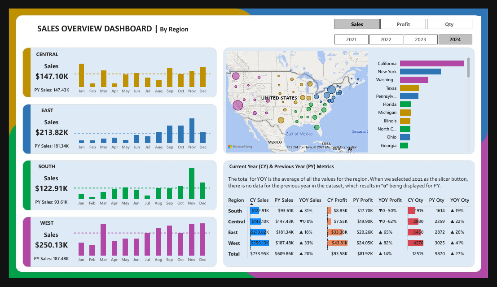

# Sales Overview by Region

Regional sales, profit and quantity dashboard with current-year vs previous-year metrics (2021-2024).

## What it shows
- Sales, profit and quantity by Central, East, South and West regions
- CY vs PY and YoY metrics per region, with state-level breakdowns
- Monthly trends, custom background and problem statement deck

## Files
- `Sales Overview By Region.pbix`: Power BI report (open in Power BI Desktop)
- `Sales Overview By Region.pdf`: exported PDF of the report
- `data/`: source data. Sales Overview Data.xlsx (included).

## Tools
Power BI, DAX, Power Query.

## Author
Asad Ullah, Data Analyst and Power BI Developer, Dammam, Saudi Arabia
[LinkedIn](https://linkedin.com/in/asadullah44) | [Portfolio](https://asadullah-the-analyst.netlify.app) | [GitHub](https://github.com/asadullah43)
